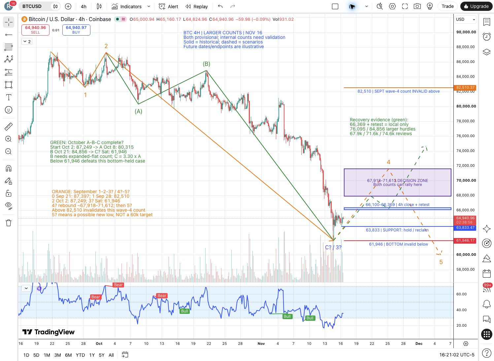

# BTC Scenario Charts and Dated Reviews

Native Coinbase BTCUSD four-hour chart captures and subsequent scenario checks.

Last Updated: 2026-11-18  
Status: Provisional scenario research; original captures preserved  
Audience: Trading Desk users

## Overview

The November 16 drawings compare a possible completed October correction
(green) with a possible September-origin decline, rebound and further decline
(orange). Dashed paths, future dates and endpoints are illustrative, not
observed future bars, confirmed forecasts or fixed price targets.

## Main captures

- [Both paths clarified](2026-11-16_BTC_TWO_SCENARIOS_CLARIFIED.jpg).
- [Support, confirmation and decision zones](2026-11-16_BTC_4H_SUPPORT_CONFIRMATION_DECISION_ZONES.jpg).
- [September and October scenario context](2026-11-16_BTC_4H_SEPT_OCT_SCENARIOS.jpg).

## Dated checks

- [November 17 morning](2026-11-17_0644_ET_SCENARIO_REVIEW.md): both paths possible, neither confirmed.
- [November 17 evening](2026-11-17_1841_ET_SCENARIO_REVIEW.md): local support broke on a completed four-hour close; reclaim was unfinished.
- [November 18 morning](2026-11-18_0643_ET_SCENARIO_REVIEW.md): local reclaim completed, with subsequent bars above support; larger recovery remains unconfirmed.

These are dated observations, not a current-price feed. The fixed bottom-held
case fails below $61,946.17; the specific orange non-overlapping wave-4 count
fails above $82,510.37. A local $63,833.47 support change is distinct from
either full count's invalidation. Internal wave counts remain provisional.

## Earlier drawing history

- [Initial scenario chart](2026-11-16_BTC_4H_SCENARIO_CHART.jpg).
- [Initial Elliott count](2026-11-16_BTC_4H_ELLIOTT_COUNT.jpg).
- [15:22 recovery view](2026-11-16_1522_ET_BTC_4H_WAVE5_RECOVERY.jpg).
- [Origin correction](2026-11-16_BTC_4H_ORIGIN_CORRECTED.jpg).
- [15:32 corrected view](2026-11-16_1532_ET_BTC_4H_CORRECTED.jpg).

[Repository map](../../docs/REPOSITORY_CONTENTS.md) ·
[BTC Live guide](../../docs/BTC_LIVE_PAPER.md).
