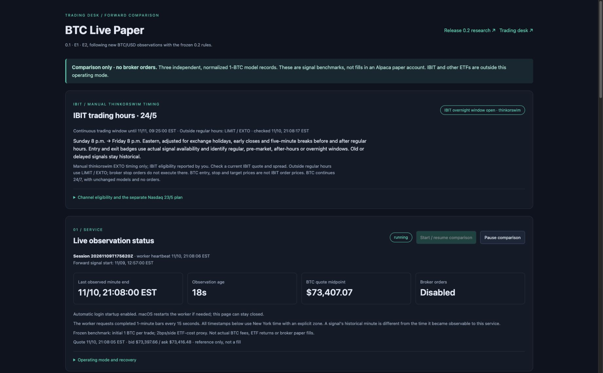

# BTC Live Paper Captures

Saved views of the comparison page and its separate discretionary review.

Last Updated: 2026-11-18  
Status: Historical screen captures  
Audience: Trading Desk users

## Overview

These native captures show the page on their stated dates. They do not show
current prices, current service health or broker fills. BTC model quantities
and P/L on the comparison page normalize to one initial BTC.

- [November 10 IBIT-hours and BTC Live status](2026-11-10_IBIT_24_5_REVIEW.png).
- [November 15 separate bottom-review panel](2026-11-15_BTC_BOTTOM_REVIEW.jpg).

[Live page source](../../trading_desk/btc_live.html) ·
[Operating guide](../../docs/BTC_LIVE_PAPER.md) ·
[Repository map](../../docs/REPOSITORY_CONTENTS.md).

